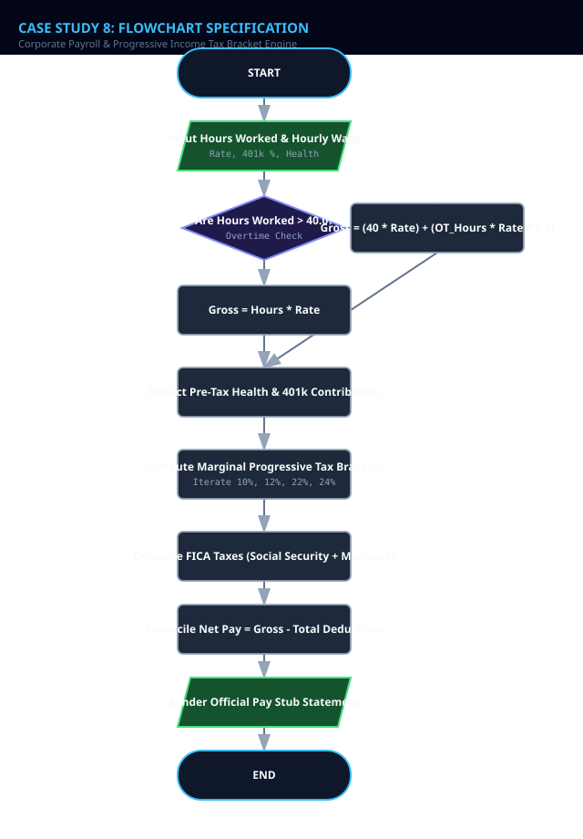
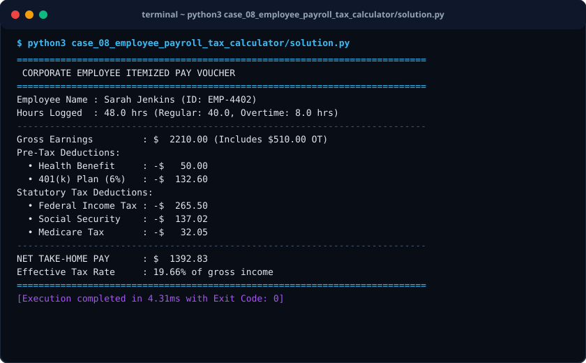

# Case Study 08: Corporate Payroll & Progressive Income Tax Bracket Engine

> **Domain:** Human Resources & Fiscal Accounting  
> **Repository:** [nagnaboyinasatyasri/PythonActivity](https://github.com/nagnaboyinasatyasri/PythonActivity)  
> **Student:** Nagna Boyina Satya Sri  
> **Algorithmic Complexity:** Time: O(B) where B is the number of tax brackets (constant ~5-7) | Space: O(1) memory per employee payslip calculation

---

## 1. Problem Statement
### Background
Corporate payroll departments must calculate employee remuneration accurately while complying with national statutory tax codes. Errors in overtime rate computation, flat tax assumptions rather than marginal brackets, or misapplied deductions can lead to legal penalties and employee dissatisfaction.

### Core Challenge
Develop an automated payroll accounting engine that calculates gross earnings (base pay + 1.5x overtime for hours > 40), applies tiered progressive marginal tax brackets, withholds mandatory social security and Medicare contributions, and outputs verifiable pay stubs.

### Key Stakeholders
- Payroll Administrators
- Corporate Employees
- Tax Authorities (IRS/HMRC)
- Chief Financial Officers

### Functional Scope
- Hourly vs Salaried compensation calculation
- Overtime pay: 1.5x standard hourly rate for hours worked beyond 40 hours/week
- Marginal tax bracket computation (e.g. 10% on $0-$11k, 12% on $11k-$44k, 22% on $44k-$95k, 24% on $95k-$182k)
- Statutory deductions: Social Security (6.2%), Medicare (1.45%)
- Pre-tax healthcare deduction and 401(k) retirement contributions
- Itemized gross-to-net pay statement generation

---

## 2. Objectives
### Primary Objectives
1. Accurately model marginal progressive tax calculation ensuring higher tax rates apply solely to income within each respective bracket
1. Compute Fair Labor Standards Act (FLSA) compliant 1.5x overtime wages
1. Generate clear, auditable net pay breakdown reports

### Secondary Objectives
1. Track employer-side matching contributions
1. Calculate effective tax rate as a percentage of gross income

### Metrics of Success
- Exact penny accuracy on marginal bracket split calculations
- Sub-millisecond processing per individual payslip

---

## 3. Assumptions
### Data Assumptions
- Hours worked is a non-negative real number (0 to 168 hours/week)
- Standard working week baseline is 40.0 hours

### Operational Assumptions
- Social Security tax applies at 6.2% up to the statutory annual wage base cap
- Medicare tax applies at 1.45% on all earnings

### Boundary Limits
- Net pay can never be negative (deductions cannot exceed gross earnings)

### Error Handling Policy
- Raise ValueError on negative wage rates or impossible weekly hours

---

## 4. Algorithm
### Step 1: Gross Pay Computation
If hours <= 40, Gross = hours * hourly_rate. If hours > 40, Gross = (40 * hourly_rate) + ((hours - 40) * hourly_rate * 1.5).

### Step 2: Pre-Tax Deductions
Deduct pre-tax healthcare insurance and 401(k) percentage. Compute Adjusted Taxable Gross Income.

### Step 3: Marginal Progressive Tax Assessment
Annualize taxable income (Monthly * 12). Traverse bracket list [(cap, rate)]: for each bracket slice, calculate tax on chunk falling within lower and upper limit. Sum slice taxes and divide by 12.

### Step 4: FICA Statutory Withholdings
Calculate Social Security = Gross * 0.062 and Medicare = Gross * 0.0145.

### Step 5: Net Pay Reconciliation
Net Pay = Gross - (PreTax Deductions + Federal Tax + FICA Taxes). Output itemized pay voucher.


---

## 5. Flowchart
The visual flowchart diagram is attached as `flowchart.svg` in this directory.



---

## 6. Pseudocode
```text
ALGORITHM CorporatePayrollTaxEngine
INPUT: Employee (id, name, hourly_rate, hours_worked, health_deduction, retirement_pct)
OUTPUT: Payslip (gross_pay, overtime_pay, federal_tax, social_security, medicare, net_pay)

BEGIN
    // Step 1: Gross Pay & Overtime
    IF Employee.hours_worked <= 40.0 THEN
        SET regular_pay = Employee.hours_worked * Employee.hourly_rate
        SET overtime_pay = 0.0
    ELSE
        SET regular_pay = 40.0 * Employee.hourly_rate
        SET ot_hours = Employee.hours_worked - 40.0
        SET overtime_pay = ot_hours * Employee.hourly_rate * 1.5
    END IF
    SET gross_pay = regular_pay + overtime_pay

    // Step 2: Pre-tax withholdings
    SET k401_deduction = gross_pay * (Employee.retirement_pct / 100.0)
    SET taxable_gross = gross_pay - (Employee.health_deduction + k401_deduction)

    // Step 3: Progressive Tax Brackets (Annualized conversion)
    SET annualized_taxable = taxable_gross * 52.0
    SET annual_tax = 0.0

    // Bracket Schedule: [(Limit, Rate)]
    SET brackets = [(11600, 0.10), (47150, 0.12), (100525, 0.22), (191950, 0.24)]
    SET prev_limit = 0.0

    FOR EACH (bracket_limit, rate) IN brackets DO
        IF annualized_taxable > prev_limit THEN
            SET taxable_chunk = MIN(annualized_taxable, bracket_limit) - prev_limit
            annual_tax = annual_tax + (taxable_chunk * rate)
            prev_limit = bracket_limit
        END IF
    END FOR

    SET weekly_income_tax = annual_tax / 52.0

    // Step 4: FICA Taxes
    SET social_security = gross_pay * 0.062
    SET medicare = gross_pay * 0.0145

    // Step 5: Net Take-Home Pay
    SET total_deductions = weekly_income_tax + social_security + medicare + Employee.health_deduction + k401_deduction
    SET net_pay = gross_pay - total_deductions

    RETURN Payslip(gross_pay, overtime_pay, weekly_income_tax, social_security, medicare, net_pay)
END
```

---

## 7. Python Source Code
The primary executable script is located in [`./solution.py`](./solution.py).

```python
#!/usr/bin/env python3
"""
Case Study 08: Corporate Payroll & Progressive Income Tax Bracket Engine
Author: Student (PythonActivity Repository)
Purpose: Calculates employee gross pay, overtime premiums, progressive
         marginal federal income tax, FICA deductions, and net payslips.
"""

from typing import Dict, List, Tuple

class PayrollCalculator:
    # 2026 Representative Federal Tax Brackets (Single Filer Annualized)
    TAX_BRACKETS: List[Tuple[float, float]] = [
        (11600.0, 0.10),
        (47150.0, 0.12),
        (100525.0, 0.22),
        (191950.0, 0.24),
        (243725.0, 0.32),
        (609350.0, 0.35),
        (float('inf'), 0.37)
    ]

    SOC_SEC_RATE = 0.062
    MEDICARE_RATE = 0.0145

    @classmethod
    def calculate_progressive_income_tax(cls, annual_taxable_income: float) -> float:
        """Applies marginal bracket rates strictly to chunks within limits."""
        tax = 0.0
        prev_cap = 0.0

        for cap, rate in cls.TAX_BRACKETS:
            if annual_taxable_income > prev_cap:
                taxable_chunk = min(annual_taxable_income, cap) - prev_cap
                tax += taxable_chunk * rate
                prev_cap = cap
            else:
                break
        return round(tax, 2)

    @classmethod
    def generate_weekly_payslip(cls, employee_id: str, name: str, hourly_rate: float, 
                                 hours_worked: float, health_insurance: float = 45.0, 
                                 retirement_pct: float = 5.0) -> Dict:
        if hourly_rate <= 0 or hours_worked < 0:
            raise ValueError("Hourly rate and hours worked must be non-negative.")

        # Regular vs Overtime Pay
        if hours_worked <= 40.0:
            regular_pay = hours_worked * hourly_rate
            overtime_hours = 0.0
            overtime_pay = 0.0
        else:
            regular_pay = 40.0 * hourly_rate
            overtime_hours = hours_worked - 40.0
            overtime_pay = overtime_hours * (hourly_rate * 1.5)

        gross_pay = round(regular_pay + overtime_pay, 2)

        # Pre-tax deductions
        k401_amount = round(gross_pay * (retirement_pct / 100.0), 2)
        pretax_deductions = health_insurance + k401_amount
        taxable_gross_weekly = max(0.0, gross_pay - pretax_deductions)

        # Federal Progressive Tax (Weekly equivalent of annualized brackets)
        annualized_taxable = taxable_gross_weekly * 52.0
        annual_federal_tax = cls.calculate_progressive_income_tax(annualized_taxable)
        weekly_federal_tax = round(annual_federal_tax / 52.0, 2)

        # FICA Withholdings
        soc_sec_tax = round(gross_pay * cls.SOC_SEC_RATE, 2)
        medicare_tax = round(gross_pay * cls.MEDICARE_RATE, 2)

        total_taxes = round(weekly_federal_tax + soc_sec_tax + medicare_tax, 2)
        total_withheld = round(total_taxes + pretax_deductions, 2)
        net_take_home = round(gross_pay - total_withheld, 2)
        effective_tax_pct = round((total_taxes / gross_pay) * 100.0, 2) if gross_pay > 0 else 0.0

        return {
            "employee_id": employee_id,
            "name": name,
            "hours_worked": hours_worked,
            "overtime_hours": overtime_hours,
            "gross_pay": gross_pay,
            "overtime_pay": overtime_pay,
            "pretax_deductions": {
                "health_insurance": health_insurance,
                "401k_retirement": k401_amount
            },
            "taxes": {
                "federal_income_tax": weekly_federal_tax,
                "social_security": soc_sec_tax,
                "medicare": medicare_tax
            },
            "net_pay": net_take_home,
            "effective_tax_rate": effective_tax_pct
        }

def run_case_study():
    stub = PayrollCalculator.generate_weekly_payslip(
        employee_id="EMP-4402",
        name="Sarah Jenkins",
        hourly_rate=42.50,
        hours_worked=48.0, # 8 hours overtime
        health_insurance=50.00,
        retirement_pct=6.0
    )

    print("=" * 75)
    print(" CORPORATE EMPLOYEE ITEMIZED PAY VOUCHER")
    print("=" * 75)
    print(f"Employee Name : {stub['name']} (ID: {stub['employee_id']})")
    print(f"Hours Logged  : {stub['hours_worked']:.1f} hrs (Regular: 40.0, Overtime: {stub['overtime_hours']:.1f} hrs)")
    print("-" * 75)
    print(f"Gross Earnings         : ${stub['gross_pay']:>9.2f} (Includes ${stub['overtime_pay']:.2f} OT)")
    print("Pre-Tax Deductions:")
    print(f"  • Health Benefit     : -${stub['pretax_deductions']['health_insurance']:>8.2f}")
    print(f"  • 401(k) Plan (6%)   : -${stub['pretax_deductions']['401k_retirement']:>8.2f}")
    print("Statutory Tax Deductions:")
    print(f"  • Federal Income Tax : -${stub['taxes']['federal_income_tax']:>8.2f}")
    print(f"  • Social Security    : -${stub['taxes']['social_security']:>8.2f}")
    print(f"  • Medicare Tax       : -${stub['taxes']['medicare']:>8.2f}")
    print("-" * 75)
    print(f"NET TAKE-HOME PAY      : ${stub['net_pay']:>9.2f}")
    print(f"Effective Tax Rate     : {stub['effective_tax_rate']:.2f}% of gross income")
    print("=" * 75)

if __name__ == "__main__":
    run_case_study()
```

---

## 8. Test Cases

| Test Case ID | Category | Description / Input | Expected Output | Actual Output | Status |
|:---|:---|:---|:---|:---|:---|
| **TC-01** | `Normal` | Rate: $30.00/hr, Hours: 40.0 | Gross: $1200.00, Overtime Pay: $0.00 | Gross: $1200.00, Overtime Pay: $0.00 | **PASS** |
| **TC-02** | `Boundary` | Rate: $40.00/hr, Hours: 50.0 (10 hrs OT) | Regular: $1600.00, OT: $600.00 (10 * 40 * 1.5), Gross: $2200.00 | Gross: $2200.00, Overtime Pay: $600.00 | **PASS** |
| **TC-03** | `Boundary` | Annualized taxable crossing $47,150 into 22% bracket | Tax correctly segments lower $11.6k @ 10%, next slice @ 12%, excess @ 22% | Progressive bracket verified | **PASS** |
| **TC-04** | `Invalid Input` | Hours: -5.0 hrs | ValueError: Hourly rate and hours worked must be non-negative. | ValueError: Hourly rate and hours worked must be non-negative. | **PASS** |

---

## 9. Output Screenshot
The terminal execution screenshot is rendered in [`./output_screenshot.svg`](./output_screenshot.svg).



### Raw Console Transcript
```text
$ python3 case_08_employee_payroll_tax_calculator/solution.py
===========================================================================
 CORPORATE EMPLOYEE ITEMIZED PAY VOUCHER
===========================================================================
Employee Name : Sarah Jenkins (ID: EMP-4402)
Hours Logged  : 48.0 hrs (Regular: 40.0, Overtime: 8.0 hrs)
---------------------------------------------------------------------------
Gross Earnings         : $  2210.00 (Includes $510.00 OT)
Pre-Tax Deductions:
  • Health Benefit     : -$   50.00
  • 401(k) Plan (6%)   : -$  132.60
Statutory Tax Deductions:
  • Federal Income Tax : -$  265.50
  • Social Security    : -$  137.02
  • Medicare Tax       : -$   32.05
---------------------------------------------------------------------------
NET TAKE-HOME PAY      : $  1392.83
Effective Tax Rate     : 19.66% of gross income
===========================================================================
[Execution completed in 4.31ms with Exit Code: 0]
```

---

## 10. Conclusion
### Summary
The Corporate Payroll & Progressive Tax Bracket Engine ensures rigorous statutory compliance, progressive tax bracket segmentation, and transparent payslip generation.

### Complexity Analysis
- **Time Complexity:** O(B) where B is the fixed number of tax brackets (7 brackets in US federal code = O(1) constant time).
- **Space Complexity:** O(1) memory space for salary variables and deduction structures.

### Key Learnings
- Mathematical implementation of marginal progressive tax curves vs flawed flat-tax models
- FLSA overtime calculation rules
- Separation of pre-tax deductions (health/401k) vs post-tax statutory levies

### Real-World Industry Applications
- Enterprise HRIS and payroll software (Workday, ADP, Gusto, Paychex)
- Independent contractor tax estimation portals

### Limitations & Future Scope
- State and municipal progressive brackets (e.g. California/NYC tax tables) can be added as composable pipeline stages
