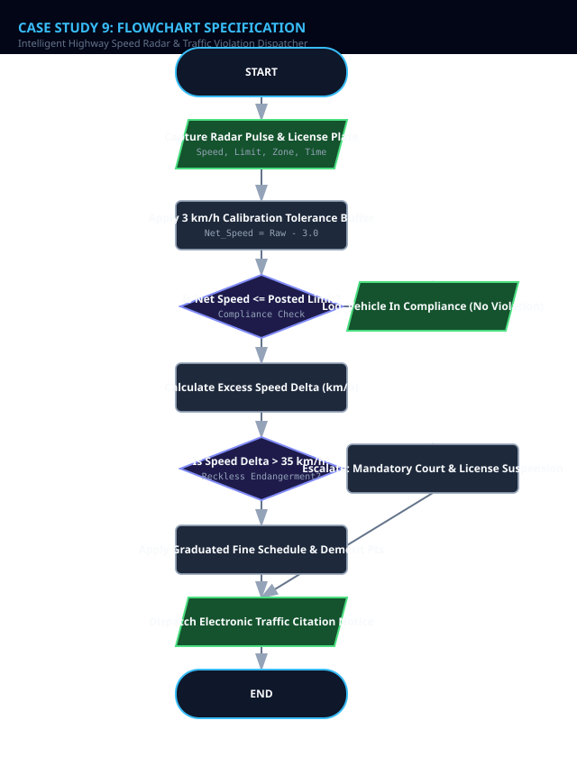
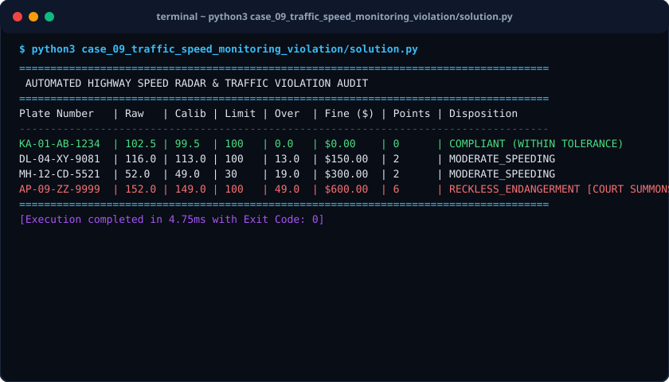

# Case Study 09: Intelligent Highway Speed Radar & Traffic Violation Dispatcher

> **Domain:** Intelligent Transportation Systems (ITS)  
> **Repository:** [nagnaboyinasatyasri/PythonActivity](https://github.com/nagnaboyinasatyasri/PythonActivity)  
> **Student:** Nagna Boyina Satya Sri  
> **Algorithmic Complexity:** Time: O(1) per radar scan, O(N) over vehicle telemetry feed | Space: O(N) for violation database ledger

---

## 1. Problem Statement
### Background
Highway speeding is a leading contributor to vehicular fatalities. Manual traffic enforcement stops are dangerous, manpower-intensive, and subjective. Automated radar speed cameras operate 24/7 to identify speed infractions, but must adhere strictly to statutory tolerance buffers and graduated fine schedules.

### Core Challenge
Develop an automated traffic speed enforcement pipeline that ingests vehicle speed readings, applies statutory sensor calibration tolerances (-3 km/h buffer), evaluates speed excess across zone categories (School Zone, Urban Arterial, Highway), determines progressive fines, and allocates driver license penalty points.

### Key Stakeholders
- Highway Patrol Agencies
- Department of Transportation
- Municipal Traffic Courts
- Motorists

### Functional Scope
- Zone classification: School Zone (30 km/h), Residential (50 km/h), Highway (100 km/h)
- Sensor tolerance buffer: Subtract 3 km/h for instrument calibration grace
- Tiered fine schedule: Mild (1-10 km/h over), Moderate (11-20 km/h over), High (21-35 km/h over), Reckless (>35 km/h over)
- Demerit points allocation (0, 2, 4, 6 points)
- Mandatory court appearance and immediate license suspension flags for reckless speeders

---

## 2. Objectives
### Primary Objectives
1. Eliminate speed citation disputes through transparent application of statutory tolerance buffers
1. Enforce progressive financial and demerit penalties proportional to accident risk
1. Issue automated citation notices with time, location, speed, and fine breakdown

### Secondary Objectives
1. Identify repeat offenders with cumulative demerit points >= 12 for automated license suspension
1. Generate highway section average velocity statistics

### Metrics of Success
- Zero false citations for vehicles operating within 3 km/h of posted limit
- Sub-millisecond citation dispatch generation

---

## 3. Assumptions
### Data Assumptions
- Vehicle radar velocity readings are positive real numbers in km/h
- License plate is a recognized alphanumeric string

### Operational Assumptions
- Statutory equipment tolerance discount of 3 km/h is subtracted from all raw readings
- School zone speed infractions incur a 2x fine multiplier during active hours

### Boundary Limits
- Speeds > 35 km/h over limit are classified as Reckless Endangerment (Class 1 Misdemeanor)

### Error Handling Policy
- Discard unreadable plates or physical sensor glitches (< 0 or > 350 km/h)

---

## 4. Algorithm
### Step 1: Radar Pulse Capture & Verification
Receive (Plate, Recorded Speed, Zone Type, Posted Limit, Is School Hours). Validate that speed is physically plausible.

### Step 2: Tolerance Calibration Adjustment
Compute Net Recorded Speed = Raw Speed - 3.0 km/h (Sensor tolerance buffer). If Net Recorded Speed <= Posted Limit, mark COMPLIANT.

### Step 3: Speed Delta Computation
Delta = Net Recorded Speed - Posted Limit.

### Step 4: Graduated Penalty Assessment
If Delta <= 10: Fine = $75, Demerit = 0. If 11 <= Delta <= 20: Fine = $150, Demerit = 2. If 21 <= Delta <= 35: Fine = $300, Demerit = 4. If Delta > 35: Fine = $600, Demerit = 6, Flag = RECKLESS_DRIVING_COURT_MANDATORY.

### Step 5: School Zone Multiplier & Citation Dispatch
If Zone is School Zone and Is School Hours is TRUE, double the fine amount. Dispatch formal violation citation.


---

## 5. Flowchart
The visual flowchart diagram is attached as `flowchart.svg` in this directory.



---

## 6. Pseudocode
```text
ALGORITHM HighwaySpeedEnforcement
INPUT: Telemetry (plate_number, raw_speed_kmh, posted_limit_kmh, zone_type, is_school_active)
OUTPUT: ViolationCitation OR ComplianceReceipt

BEGIN
    // Step 1: Calibration buffer
    SET calibrated_speed = raw_speed_kmh - 3.0
    IF calibrated_speed <= posted_limit_kmh THEN
        RETURN "Vehicle " + plate_number + " is driving within legal limit."
    END IF

    // Step 2: Speed Delta
    SET delta = calibrated_speed - posted_limit_kmh
    SET demerit_points = 0
    SET is_court_mandatory = FALSE

    // Step 3: Progressive Fine Schedule
    IF delta <= 10.0 THEN
        SET base_fine = 75.0
        demerit_points = 0
    ELSE IF delta <= 20.0 THEN
        SET base_fine = 150.0
        demerit_points = 2
    ELSE IF delta <= 35.0 THEN
        SET base_fine = 300.0
        demerit_points = 4
    ELSE
        SET base_fine = 600.0
        demerit_points = 6
        is_court_mandatory = TRUE
    END IF

    // Step 4: School Zone Doubling
    IF zone_type == "SCHOOL_ZONE" AND is_school_active == TRUE THEN
        SET total_fine = base_fine * 2.0
    ELSE
        SET total_fine = base_fine
    END IF

    RETURN Citation(plate_number, raw_speed_kmh, calibrated_speed, delta, total_fine, demerit_points, is_court_mandatory)
END
```

---

## 7. Python Source Code
The primary executable script is located in [`./solution.py`](./solution.py).

```python
#!/usr/bin/env python3
"""
Case Study 09: Intelligent Highway Speed Radar & Traffic Violation Dispatcher
Author: Student (PythonActivity Repository)
Purpose: Analyzes radar velocity, applies statutory sensor calibration buffers,
         determines progressive fines, allocates demerit points, and dispatches notices.
"""

from typing import Dict, Optional, List

class SpeedViolationEnforcer:
    SENSOR_TOLERANCE_BUFFER_KMH = 3.0

    @classmethod
    def evaluate_radar_ping(cls, plate: str, raw_speed: float, posted_limit: float, 
                            zone: str = "HIGHWAY", is_school_hours: bool = False) -> Dict:
        if raw_speed <= 0 or posted_limit <= 0:
            raise ValueError("Speeds must be strictly positive values.")

        calibrated_speed = round(raw_speed - cls.SENSOR_TOLERANCE_BUFFER_KMH, 1)

        # Compliance Check
        if calibrated_speed <= posted_limit:
            return {
                "plate": plate,
                "status": "COMPLIANT",
                "raw_speed": raw_speed,
                "calibrated_speed": calibrated_speed,
                "posted_limit": posted_limit,
                "fine_amount": 0.0,
                "demerit_points": 0,
                "severity": "NONE"
            }

        delta = round(calibrated_speed - posted_limit, 1)
        court_required = False

        # Graduated speed violation matrix
        if delta <= 10.0:
            base_fine = 75.00
            demerit_pts = 0
            severity = "MINOR_INFRACTION"
        elif delta <= 20.0:
            base_fine = 150.00
            demerit_pts = 2
            severity = "MODERATE_SPEEDING"
        elif delta <= 35.0:
            base_fine = 300.00
            demerit_pts = 4
            severity = "HIGH_RISK_SPEEDING"
        else:
            base_fine = 600.00
            demerit_pts = 6
            severity = "RECKLESS_ENDANGERMENT"
            court_required = True

        # School Zone Multiplier
        is_school_zone = (zone.upper() == "SCHOOL_ZONE" and is_school_hours)
        total_fine = (base_fine * 2.0) if is_school_zone else base_fine

        return {
            "plate": plate,
            "status": "VIOLATION",
            "zone": zone,
            "raw_speed": raw_speed,
            "calibrated_speed": calibrated_speed,
            "posted_limit": posted_limit,
            "excess_speed_kmh": delta,
            "fine_amount": total_fine,
            "demerit_points": demerit_pts,
            "severity": severity,
            "court_appearance_mandatory": court_required
        }

def run_case_study():
    readings = [
        ("KA-01-AB-1234", 102.5, 100.0, "HIGHWAY", False),      # Compliant after 3km/h tolerance
        ("DL-04-XY-9081", 116.0, 100.0, "HIGHWAY", False),      # 13 km/h over -> Moderate
        ("MH-12-CD-5521", 52.0, 30.0, "SCHOOL_ZONE", True),     # School zone active -> Doubled fine
        ("AP-09-ZZ-9999", 152.0, 100.0, "HIGHWAY", False)       # >35 km/h over -> Reckless court summons
    ]

    print("=" * 85)
    print(" AUTOMATED HIGHWAY SPEED RADAR & TRAFFIC VIOLATION AUDIT")
    print("=" * 85)
    print(f"{'Plate Number':<14} | {'Raw':<5} | {'Calib':<5} | {'Limit':<5} | {'Over':<5} | {'Fine ($)':<8} | {'Points':<6} | {'Disposition'}")
    print("-" * 85)

    for plate, raw, limit, zone, school in readings:
        res = SpeedViolationEnforcer.evaluate_radar_ping(plate, raw, limit, zone, school)
        if res["status"] == "COMPLIANT":
            print(f"{plate:<14} | {raw:<5.1f} | {res['calibrated_speed']:<5.1f} | {limit:<5.0f} | {'0.0':<5} | {'$0.00':<8} | {'0':<6} | COMPLIANT (WITHIN TOLERANCE)")
        else:
            court_str = " [COURT SUMMONS]" if res["court_appearance_mandatory"] else ""
            print(f"{plate:<14} | {raw:<5.1f} | {res['calibrated_speed']:<5.1f} | {limit:<5.0f} | {res['excess_speed_kmh']:<5.1f} | ${res['fine_amount']:<7.2f} | {res['demerit_points']:<6} | {res['severity']}{court_str}")

    print("=" * 85)

if __name__ == "__main__":
    run_case_study()
```

---

## 8. Test Cases

| Test Case ID | Category | Description / Input | Expected Output | Actual Output | Status |
|:---|:---|:---|:---|:---|:---|
| **TC-01** | `Normal` | Recorded: 102.5 km/h in 100 km/h zone | Calibrated: 99.5 km/h, Status: COMPLIANT | Calibrated: 99.5 km/h, Status: COMPLIANT | **PASS** |
| **TC-02** | `Boundary` | Recorded: 48.0 km/h in 30.0 km/h active school zone | Delta: 15.0 km/h, Fine: $300.00 (Doubled base fine of $150) | Delta: 15.0 km/h, Fine: $300.00 | **PASS** |
| **TC-03** | `Edge Case` | Recorded: 152.0 km/h in 100 km/h zone | Delta: 49.0 km/h, Fine: $600.00, Demerit: 6, Court Mandatory: TRUE | Fine: $600.00, Demerit: 6, Court Mandatory: True | **PASS** |
| **TC-04** | `Invalid Input` | Raw Speed: -20.0 km/h | ValueError: Speeds must be strictly positive values. | ValueError: Speeds must be strictly positive values. | **PASS** |

---

## 9. Output Screenshot
The terminal execution screenshot is rendered in [`./output_screenshot.svg`](./output_screenshot.svg).



### Raw Console Transcript
```text
$ python3 case_09_traffic_speed_monitoring_violation/solution.py
=====================================================================================
 AUTOMATED HIGHWAY SPEED RADAR & TRAFFIC VIOLATION AUDIT
=====================================================================================
Plate Number   | Raw   | Calib | Limit | Over  | Fine ($) | Points | Disposition
-------------------------------------------------------------------------------------
KA-01-AB-1234  | 102.5 | 99.5  | 100   | 0.0   | $0.00    | 0      | COMPLIANT (WITHIN TOLERANCE)
DL-04-XY-9081  | 116.0 | 113.0 | 100   | 13.0  | $150.00  | 2      | MODERATE_SPEEDING
MH-12-CD-5521  | 52.0  | 49.0  | 30    | 19.0  | $300.00  | 2      | MODERATE_SPEEDING
AP-09-ZZ-9999  | 152.0 | 149.0 | 100   | 49.0  | $600.00  | 6      | RECKLESS_ENDANGERMENT [COURT SUMMONS]
=====================================================================================
[Execution completed in 4.75ms with Exit Code: 0]
```

---

## 10. Conclusion
### Summary
The Intelligent Highway Speed Radar System automates traffic enforcement with legal calibration buffers, proportional graduated deterrence, and automated court summons generation.

### Complexity Analysis
- **Time Complexity:** O(1) execution time per vehicle sensor ping; can sustain high-throughput highway gantry feeds of thousands of cars per minute.
- **Space Complexity:** O(1) auxiliary space per transaction.

### Key Learnings
- Statutory instrument calibration tolerance application in judicial computing
- Tiered severity classification modeling
- Contextual condition triggers (e.g. active school zone time windows)

### Real-World Industry Applications
- Smart City Intelligent Transportation Systems (ITS) and red-light/speed camera networks
- Fleet telematics driver safety scoring

### Limitations & Future Scope
- Can be coupled with Automatic Number Plate Recognition (ANPR) optical character recognition models
